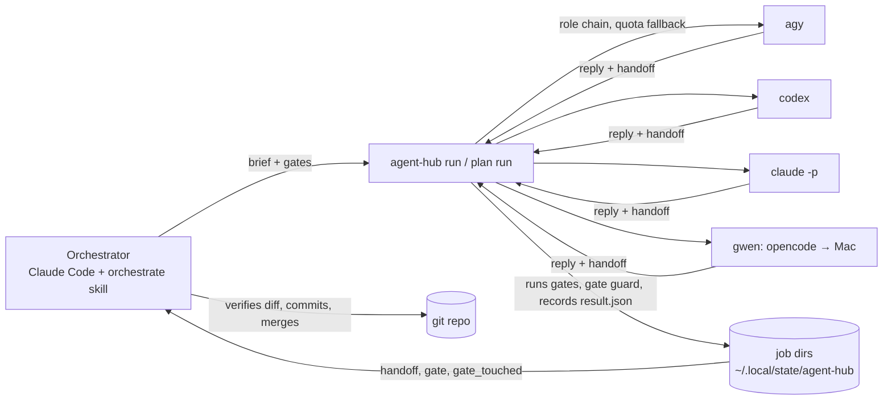

# Agent system overview

State on 2026-10-12: agent-hub v0.8.0 (tiered routing, the local agent gwen, pstack trust mechanics), agent-plugins
marketplace with four plugins. This page explains how the pieces
fit together, how this machine is set up, how changes are tested, and what was learned. Commands and flags are in
`README.md`; every design choice and its reason is in `docs/decisions.md` (D-xxx) and
`~/Workspaces/tools/agent-plugins/docs/decisions.md` (P-xxx, token audit T-xxx).

## 1. What it is for

One agent — Claude Code on Opus, the **director** — decomposes, briefs, verifies and merges; it never writes product
code (D-058). Other agents do the **implementation** and the **reviews**, picked by **tier** (D-059..D-061): agy
(Gemini and Claude models), codex (GPT), Claude Code headless (Haiku, Sonnet) and **gwen**, a local Qwen3.5-9B on the
owner's MacBook Air driven through opencode (D-069). The first goal is saving Claude quota (D-057). Everything needed
to verify a job is written to disk, nothing an agent says counts as evidence until a command has checked it, and a
branch merges only when `agent-hub ready` says its exact HEAD was gated and approved by someone other than its
implementer (D-075, D-080). The style follows Lauren Tan's pstack (D-063, D-071..D-076).

## 2. Pieces

| Piece | Where | Role |
|---|---|---|
| `agent-hub` CLI | `~/Workspaces/tools/agent-hub` | Runs jobs on the agent pool, walks role chains with quota fallback, records results, runs gates, runs plans |
| Adapters | `agenthub/agents/{agy,codex,claude,gwen}/` | One directory per agent: how to call it, how to read its output, `profile.md` with its habits |
| `orchestrate` + `principle-*` skills | `skills/` | pstack-style mode skill (non-negotiables, routing, principles, loop) and seven leaf principles; names no vendor |
| Role agents | `agents/*.md` | `implementer` (Haiku), `explorer` (Haiku, read-only), `reviewer-correctness`/`-design` (Sonnet), `reviewer-evidence` (Haiku) for Claude Code's Agent tool |
| gwen host | MacBook Air M2 16 GB, `scripts/gwen-host.sh`, `scripts/gwen-host/` | Rapid-MLX (pinned 0.15.7) on loopback behind `gwen-tap` on the Tailscale address; output log `~/Library/Logs/gwen/output.log`, live stats `gwen-watch` |
| gwen bench | `bench/gwen/` | fixture + six tasks with hidden tests, recording proxy, Mac memory sampler, report; results in `bench/gwen/results/` |
| agent-plugins marketplace | `~/Workspaces/tools/agent-plugins` | The "skills hub": every self-built plugin, installed with one marketplace registration |
| Plugins | `agent-hub` (code, own repo), `telaf`, `aspice`, `token-audit` (content, in the marketplace repo) | Skills for Claude sessions |
| Jev (optional) | `jev-code` CLI + Ollama `nimble` | Cheap local classifier, used only to infer a missing handoff |

## 3. Routing and the loop

| Tier (`--role`) | Pick when | Default chain |
|---|---|---|
| `implement-small` | ≤ 2 files, ≤ ~100 lines, fully specified, small repository (D-079) | gwen → claude:haiku |
| `implement` | specified, several files, ≤ ~400 lines | claude:haiku → agy Sonnet → agy Gemini → codex |
| `implement-hard` | unsettled design, cross-cutting, concurrency/security, unknown-cause bug | agy Opus → agy Sonnet → codex → claude:sonnet |
| `review` | every review | agy Opus → codex → agy Gemini → claude:sonnet |

A failed gate escalates one tier (plan mode does it, single runs by hand), from a clean tree with the gate tail
(D-061, D-068). `agent-hub pool` is the live truth; a user `pool.toml` overrides it.

1. **Decompose** until each task fits a tier; pick the tier (`principle-route-by-tier`).
2. **Brief** from `brief-template.md`: Goal / Input / Expected output (lead with *Done means*) / Constraints / Gate.
   The CLI appends the standing orders and the handoff footer with its escape hatch (D-064, D-073).
3. **Worktree** on a feature branch; plan mode makes `orch/<slug>/<task>` worktrees itself.
4. **Run in the background, wait in the foreground** (`agent-hub run --role <tier> … --json`, then
   `agent-hub wait -d <wt>` until it stops returning 124). Repository default gates in `.agent-hub/config.toml` run on
   every implement job (D-072); `--allow <glob>` limits the files it may change (D-071).
5. **Read** `status`, `handoff` (Verification may be `inconclusive`), `gate`, `gate_touched`, `scope_violation`.
6. **Verify yourself** (diff, every `gate_touched` hunk, real data). Commit if the agent did not (plan mode
   autocommits gated work, D-067).
7. **Gate the commit, review, check**: `agent-hub gate -d <wt>` (gates from the merge base, D-080) → `agent-hub run
   --role review -d <wt> --base <default>` (never on an implementer's model, D-062) → `agent-hub ready -d <wt>` → merge only when it says `ready: <sha>`. Gate-touched findings are judged by the
   independent reviewer (`## Gate-touched`, legitimate/weakening), never by the director; a weakening blocks (D-081).
8. **Long sessions**: at phase boundaries put state on disk and compact (D-035).

Plan mode (`agent-hub plan run` + `plan wait`) runs a task graph in parallel worktrees, retries by cause, escalates by
tier, writes `decisions.tsv` (`plan status --trail`, D-074) and stops on `plan cancel` (D-078).

## 4. Job record

Every job leaves `~/.local/state/agent-hub/jobs/<id>/`: `request.json`, the exact `brief.md` sent, one directory per
attempt (stdout, stderr, reply), `gate/<n>.log`, `diff.patch` for reviews, and `result.json`:

| Field | Meaning |
|---|---|
| `status`, `exit_code` | `ok` 0, `failed` 1, `refused` 3, `exhausted` 4, `modified-tree` 5, `timeout` 6, `empty` 7, `interrupted` 8, `gate-failed` 9, `cancelled` 130 |
| `agent`, `model`, `attempts` | which link actually ran; skipped links and why (cooldown, not installed, quota…) |
| `handoff` / `handoff_missing` | the agent's structured final message, parsed (D-031) |
| `handoff_inferred` | Jev's reading of a reply without a handoff, with probability and auto/review (D-037) |
| `gate` | each gate command's rc, duration and output tail, run by the CLI (D-032) |
| `gate_touched` | changes that can weaken the gate: removed asserts, added skips, deleted tests, gate config edits (D-038) |
| `changed_files`, `diffstat` | what changed since the job started |
| `head`, gate `sha` | the commit the job ended on and each gate ran on (D-075) |
| `verdict` | review only: `approve` / `request-changes` (D-075) |
| `repo` | the git common dir — which project owns the job (D-078) |
| `scope_violation` | files changed outside `--allow` (D-071) |

## 5. Safety rules built in

- The CLI refuses implement jobs on the default branch or a detached HEAD.
- Fallback to the next agent only while the work tree is unchanged.
- Reviewers never get a shell: they read a precomputed diff (D-021); a review that changes the tree fails.
- The agents' environment drops secret-looking variables; Claude Code session variables are removed.
- Git commands the CLI runs ignore repository-configured executables (fsmonitor, hooks, external diff, textconv);
  the sandboxed agent (codex) cannot write the git directory (D-024, D-025).
- `cancel` verifies the process start time before signalling; agent text is sanitised on a terminal (D-022, D-023).
- A project cancels only its own jobs: `cancel`, `cancel --all`, `plan cancel` refuse other repositories (D-078) —
  added after another project's blanket cancel stopped two agent-hub jobs on 2026-10-11.
- Every agent process gets `PWD` = its work tree (D-053); headless Claude workers ignore user settings (D-065).
- Standing orders are paired with what enforces them (`agent-hub orders`, D-071); repo gates come from the trusted
  merge base (D-080).

## 6. This machine

- Claude Code plugins (user scope): `superpowers`, `security-guidance`, `agent-hub@agent-plugins`,
  `token-audit@agent-plugins` (~51 always-on tokens; runs only on `/token-audit`).
- Per project (`--scope local`): `telaf` in the four TelAF projects, `aspice` in `ai_for_work/automotive_ai`.
- Removed in the 2026-10-08 audit (restore steps in agent-plugins `docs/token-audit-2026-10-08.md`): the
  claude.ai-synced `engineering` and `data` plugins (~2,000 tokens/session, 18 idle MCP servers), claude-ctags, 11
  unused plugins, 4 marketplaces, the antigravity plugin, two unused MCP servers.
- Fixed per-session cost measured by `/token-audit`: ~23k tokens for a fresh request (was ~48k before the cleanup).
- Ollama 0.40.1 (system service) with `nimble` for Jev; `jev-code` in `~/.local/share/jev-code`, linked as
  `~/.local/bin/jev-code`. Use `--jev` or `AGENT_HUB_JEV=1`. The old user-space Ollama 0.30.6 was moved to
  `~/.local/bin/ollama-0.30.6.bak` because it shadowed the service. Jev runs on CPU; setting `OLLAMA_IGPU_ENABLE=1`
  in the service would let it use the Radeon 780M.
- Routing by tier (§3). Quota on 2026-10-12: agy Claude models back 16:16 UTC; codex monthly limit until 2026-11-07.
- gwen: `scripts/gwen-host.sh {install,switch <model> [flags],status,stop,logs}`; current `qwen3.5-9b-4bit
  --cache-memory-mb 1024`; API key `~/.config/gwen/api-key` on both machines; only Qwen3.5-9B on the Mac.

## 7. How changes are tested

| Level | How | Where |
|---|---|---|
| Unit / integration | pytest with fake `agy`/`codex`/`claude`/`opencode` executables; autouse fixtures keep state, config, cwd and env isolated | `tests/` (≈465 tests) |
| Local model | `python -m bench.gwen.run` / `report`: harness × model × six tasks with hidden tests, through a recording proxy | `bench/gwen/` (D-046, D-069, D-070) |
| Gate | `just lint`, `uv run pytest -q`, run by the CLI after every delegated job | `--gate` |
| Real agents | `just smoke`: a tiny implement + review per installed agent | `scripts/smoke.sh` |
| Skill behaviour | fresh headless Claude Code sessions on a temp repo, with and without the skill; read the transcript | `scripts/skill-test/` (D-027) |
| Content plugins | `claude plugin eval` with ground-truth graders, legacy vs new, Sonnet judge | agent-plugins `evals/`, P-008..P-011 |

## 8. Lessons

- **Gates beat claims.** An agent reported "lint passes" while leaving eight scratch files; the CLI gate caught it.
- **Gates are not enough.** Green gates hid an empty report section, a vacuous test behind a `mock_scan` flag, tests
  writing into the repo root and leaking environment variables. Running the result on real data caught them.
- **Synthetic fixtures lie.** Real `/context` output and real commits found bugs that hand-written fixtures did not.
- **A classifier must not clear a gate.** Jev auto-accepted `assert` → `pass` as benign (p 0.95); the gate guard is
  deterministic instead.
- **Judges need checking too.** The default eval judge failed correct answers; reruns used a stronger judge.
- **Long sessions are the expensive part.** Every tool call re-reads the whole context (this session reached ~424k
  tokens per request); plan mode and phase-boundary compaction exist to shorten that.
- **Test skills like code.** Two of two fresh sessions ended their turn with a job still running until the skill and
  `agent-hub wait` changed.
- **Vendor benchmarks did not pick the model** (2026-10-11). Granite 4.2 8B and Gemma 4 12B beat Qwen3.5-9B on
  SWE-bench/LiveCodeBench but scored 1/6 vs 4/6 in an agent harness: tool-calling reliability decided it.
- **A bench measures its environment first.** Four "model" failures were a cache cap, a KV projection, a sleeping Mac
  and an inherited `PWD`; preflight + `infra_error` keep such runs out of the score (D-049, D-053).
- **Fixtures hide scale.** gwen passed ~75 % of small fixture tasks but timed out on the 110-file agent-hub repo
  (D-079).
- **Escalation works.** Plan mode escalated gwen → Haiku and Haiku → Sonnet on real tasks, and the higher tier passed.
- **Dogfooding the merge check found its holes.** Two reviews of the `ready` branch found `--gate true` and a
  weakened `.agent-hub/config.toml` passing it; it merged only after `ready` said yes (D-080).
- **No bypass, ever** (D-081, D-082). A director-side `--accept-touched` was removed; eight independent review rounds
  then found and closed real holes in gate-guard before the branch could merge.
- **Rules need enforcers.** Written standing orders were the weakest layer; most now map to a check (D-071).

## 9. Next

- B — the hub: install skills (including `telaf`, `aspice`) for agy, codex and opencode, not only Claude (D-019, D-077).
- C — a C++ fixture for the gwen bench before C++ tasks go to gwen (D-077).
- `docs/follow-ups.md`: review findings and small items, good `implement-small` work on small repositories.
- `plan merge` (merge `done` branches through `agent-hub ready`); vsndevenv module and GUI page; GitHub remotes.

## 10. Decision index

agent-hub (`docs/decisions.md`): D-001–D-007 shape and roles (owner's choices) · D-008–D-020 CLI behaviour and
execution · D-021–D-025 security review fixes · D-026–D-027 `wait` and skill testing · D-028–D-029 plugin and
marketplace · D-030–D-034 handoffs, gates, plan mode (from Cursor's orchestrate) · D-035 compaction (from ECC) ·
D-036 `wait` robustness · D-037 Jev · D-038 gate guard · D-039–D-056 gwen host, bench, serving · D-057–D-068 tiered
routing, escalation, standing orders, pstack-style skills · D-069–D-070, D-079 gwen's model and limits · D-071–D-076,
D-080 pstack trust mechanics (enforced rules, escape hatch, decision trail, verdicts on commits) · D-077 automotive
repos · D-078 scoped cancel · D-079 gwen on small repos · D-081–D-082 no gate bypass.
agent-plugins (`docs/decisions.md`): P-001–P-007 marketplace and the TelAF/ASPICE rewrite · P-008–P-011 evaluation
· P-012 everything-claude-code (not installed; ideas taken) · P-013 token-audit · token audit T-001–T-007.
