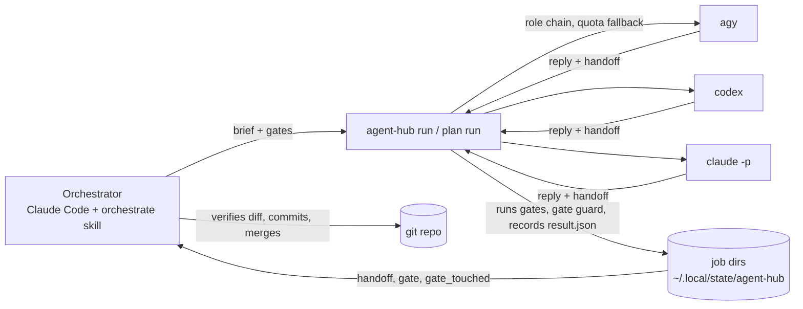

# Agent system overview

State on 2026-10-08: agent-hub v0.4.0, agent-plugins marketplace with four plugins. This page explains how the pieces
fit together, how this machine is set up, how changes are tested, and what was learned. Commands and flags are in
`README.md`; every design choice and its reason is in `docs/decisions.md` (D-xxx) and
`~/Workspaces/tools/agent-plugins/docs/decisions.md` (P-xxx, token audit T-xxx).

## 1. What it is for

One agent — Claude Code, the **orchestrator** — designs, plans, verifies and decides. Other coding agents on the
machine (agy with Gemini/Claude models, codex with GPT models, Claude Code headless) do the **implementation** and give
**second-opinion reviews**. Everything the orchestrator needs to verify a delegated job is written to disk, and nothing
an agent says counts as evidence until a command has checked it.

## 2. Pieces

| Piece | Where | Role |
|---|---|---|
| `agent-hub` CLI | `~/Workspaces/tools/agent-hub` | Runs jobs on the agent pool, walks role chains with quota fallback, records results, runs gates, runs plans |
| Adapters | `agenthub/agents/{agy,codex,claude}/` | One directory per agent: how to call it, how to read its output, `profile.md` with its habits |
| `orchestrate` skill | `skills/orchestrate/SKILL.md` | Teaches the orchestrator the loop below; names no agent |
| agent-plugins marketplace | `~/Workspaces/tools/agent-plugins` | The "skills hub": every self-built plugin, installed with one marketplace registration |
| Plugins | `agent-hub` (code, own repo), `telaf`, `aspice`, `token-audit` (content, in the marketplace repo) | Skills for Claude sessions |
| Jev (optional) | `jev-code` CLI + Ollama `nimble` | Cheap local classifier, used only to infer a missing handoff |

## 3. The loop

1. **Decide** what to delegate: implementation and second-opinion review only; small edits are done directly.
2. **Pool and profiles**: `agent-hub pool` shows each role's chain and cooldowns; `agent-hub profile <agent>` shows
   what to watch for (for example Gemini writing assertion-free tests).
3. **Brief** from `brief-template.md`: Goal / Input / Expected output / Constraints / Gate. Implement briefs without
   `## Input` and `## Expected output` are refused.
4. **Worktree** on a feature branch (single jobs); plan mode creates `orch/<slug>/<task>` worktrees itself.
5. **Run in the background, then wait in the foreground**: `agent-hub run … --gate "just lint" --gate "…tests…" --json`
   with `run_in_background`, then `agent-hub wait -d <worktree> --timeout 9m` until it stops returning 124. Never end
   a turn while a job runs — nothing wakes the session afterwards (found by skill testing, D-026).
6. **Read the result**: `status`, the parsed `handoff` (`success · unit-test-verified`), the `gate` results run by
   the CLI, and `gate_touched` (tests or lint config the agent changed).
7. **Verify yourself**: read the diff, read every `gate_touched` hunk, scan new tests for missing assertions, **run
   the result on real data**. Then commit (some agents cannot commit by design) and merge.
8. **Second opinion** when it matters: `--role review`, preferably on a different vendor.
9. **Long sessions**: at phase boundaries, put state on disk and compact or start a new session (D-035).

Several tasks at once: write a plan file and use `agent-hub plan run` (background) + `plan wait`. Tasks run in
parallel worktrees, dependants start from their upstream branch, upstream handoffs are relayed, failures retry by
cause (D-034), and merging into the base stays with the orchestrator.

## 4. Job record

Every job leaves `~/.local/state/agent-hub/jobs/<id>/`: `request.json`, the exact `brief.md` sent, one directory per
attempt (stdout, stderr, reply), `gate/<n>.log`, `diff.patch` for reviews, and `result.json`:

| Field | Meaning |
|---|---|
| `status`, `exit_code` | `ok` 0, `failed` 1, `refused` 3, `exhausted` 4, `modified-tree` 5, `timeout` 6, `empty` 7, `interrupted` 8, `gate-failed` 9, `cancelled` 130 |
| `agent`, `model`, `attempts` | which link actually ran; skipped links and why (cooldown, not installed, quota…) |
| `handoff` / `handoff_missing` | the agent's structured final message, parsed (D-031) |
| `handoff_inferred` | Jev's reading of a reply without a handoff, with probability and auto/review (D-037) |
| `gate` | each gate command's rc, duration and output tail, run by the CLI (D-032) |
| `gate_touched` | changes that can weaken the gate: removed asserts, added skips, deleted tests, gate config edits (D-038) |
| `changed_files`, `diffstat` | what changed since the job started |

## 5. Safety rules built in

- The CLI refuses implement jobs on the default branch or a detached HEAD.
- Fallback to the next agent only while the work tree is unchanged.
- Reviewers never get a shell: they read a precomputed diff (D-021); a review that changes the tree fails.
- The agents' environment drops secret-looking variables; Claude Code session variables are removed.
- Git commands the CLI runs ignore repository-configured executables (fsmonitor, hooks, external diff, textconv);
  the sandboxed agent (codex) cannot write the git directory (D-024, D-025).
- `cancel` verifies the process start time before signalling; agent text is sanitised on a terminal (D-022, D-023).

## 6. This machine

- Claude Code plugins (user scope): `superpowers`, `security-guidance`, `agent-hub@agent-plugins`,
  `token-audit@agent-plugins` (~51 always-on tokens; runs only on `/token-audit`).
- Per project (`--scope local`): `telaf` in the four TelAF projects, `aspice` in `ai_for_work/automotive_ai`.
- Removed in the 2026-10-08 audit (restore steps in agent-plugins `docs/token-audit-2026-10-08.md`): the
  claude.ai-synced `engineering` and `data` plugins (~2,000 tokens/session, 18 idle MCP servers), claude-ctags, 11
  unused plugins, 4 marketplaces, the antigravity plugin, two unused MCP servers.
- Fixed per-session cost measured by `/token-audit`: ~23k tokens for a fresh request (was ~48k before the cleanup).
- Ollama 0.40.1 (system service) with `nimble` for Jev; `jev-code` in `~/.local/share/jev-code`, linked as
  `~/.local/bin/jev-code`. Use `--jev` or `AGENT_HUB_JEV=1`. The old user-space Ollama 0.30.6 was moved to
  `~/.local/bin/ollama-0.30.6.bak` because it shadowed the service. Jev runs on CPU; setting `OLLAMA_IGPU_ENABLE=1`
  in the service would let it use the Radeon 780M.
- Delegation order today: agy Claude models (quota until ~2026-10-12) → agy Gemini 3.1 Pro → codex GPT-5.6 →
  Claude Sonnet headless; reviews start with codex.

## 7. How changes are tested

| Level | How | Where |
|---|---|---|
| Unit / integration | pytest with fake `agy`/`codex`/`claude` executables; autouse fixtures keep state, config, cwd and env isolated | `tests/` (≈260 tests) |
| Gate | `just lint`, `uv run pytest -q`, run by the CLI after every delegated job | `--gate` |
| Real agents | `just smoke`: a tiny implement + review per installed agent | `scripts/smoke.sh` |
| Skill behaviour | fresh headless Claude Code sessions on a temp repo, with and without the skill; read the transcript | `scripts/skill-test/` (D-027) |
| Content plugins | `claude plugin eval` with ground-truth graders, legacy vs new, Sonnet judge | agent-plugins `evals/`, P-008..P-011 |

## 8. Lessons (2026-10-08)

- **Gates beat claims.** An agent reported "lint passes" while leaving eight scratch files; the CLI gate caught it.
- **Gates are not enough.** Green gates hid an empty report section, a vacuous test behind a `mock_scan` flag, tests
  writing into the repo root and leaking environment variables. Running the result on real data caught them.
- **Synthetic fixtures lie.** Real `/context` output and real commits found bugs that hand-written fixtures did not.
- **A classifier must not clear a gate.** Jev auto-accepted `assert` → `pass` as benign (p 0.95); the gate guard is
  deterministic instead.
- **Judges need checking too.** The default eval judge failed correct answers; reruns used a stronger judge.
- **Long sessions are the expensive part.** Every tool call re-reads the whole context (this session reached ~424k
  tokens per request); plan mode and phase-boundary compaction exist to shorten that.
- **Test skills like code.** Two of two fresh sessions ended their turn with a job still running until the skill and
  `agent-hub wait` changed.

## 9. Next

- `plan merge`: merge `done` branches into the base after re-running their gates (D-035).
- The hub proper: install plugins, skills and MCP servers for codex and agy, not only Claude.
- vsndevenv module and GUI page for agent-hub and the marketplace; GitHub remotes for both repositories.
- Next topic: a harness for a local model agent on another machine, driven by the orchestrator.

## 10. Decision index

agent-hub (`docs/decisions.md`): D-001–D-007 shape and roles (owner's choices) · D-008–D-020 CLI behaviour and
execution · D-021–D-025 security review fixes · D-026–D-027 `wait` and skill testing · D-028–D-029 plugin and
marketplace · D-030–D-034 handoffs, gates, plan mode (from Cursor's orchestrate) · D-035 compaction (from ECC) ·
D-036 `wait` robustness · D-037 Jev · D-038 gate guard.
agent-plugins (`docs/decisions.md`): P-001–P-007 marketplace and the TelAF/ASPICE rewrite · P-008–P-011 evaluation
· P-012 everything-claude-code (not installed; ideas taken) · P-013 token-audit · token audit T-001–T-007.
